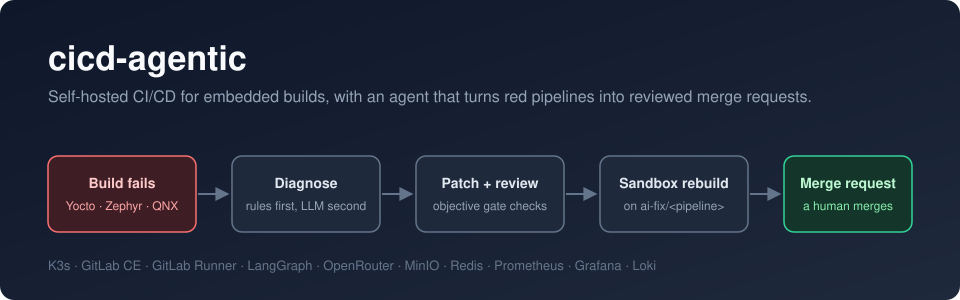
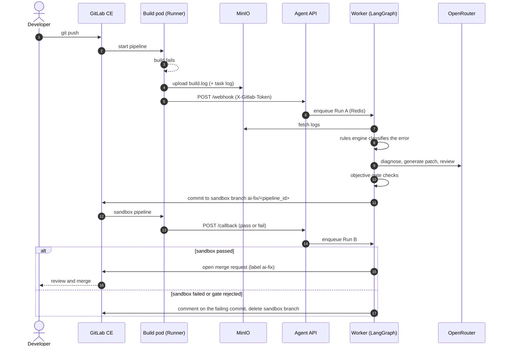
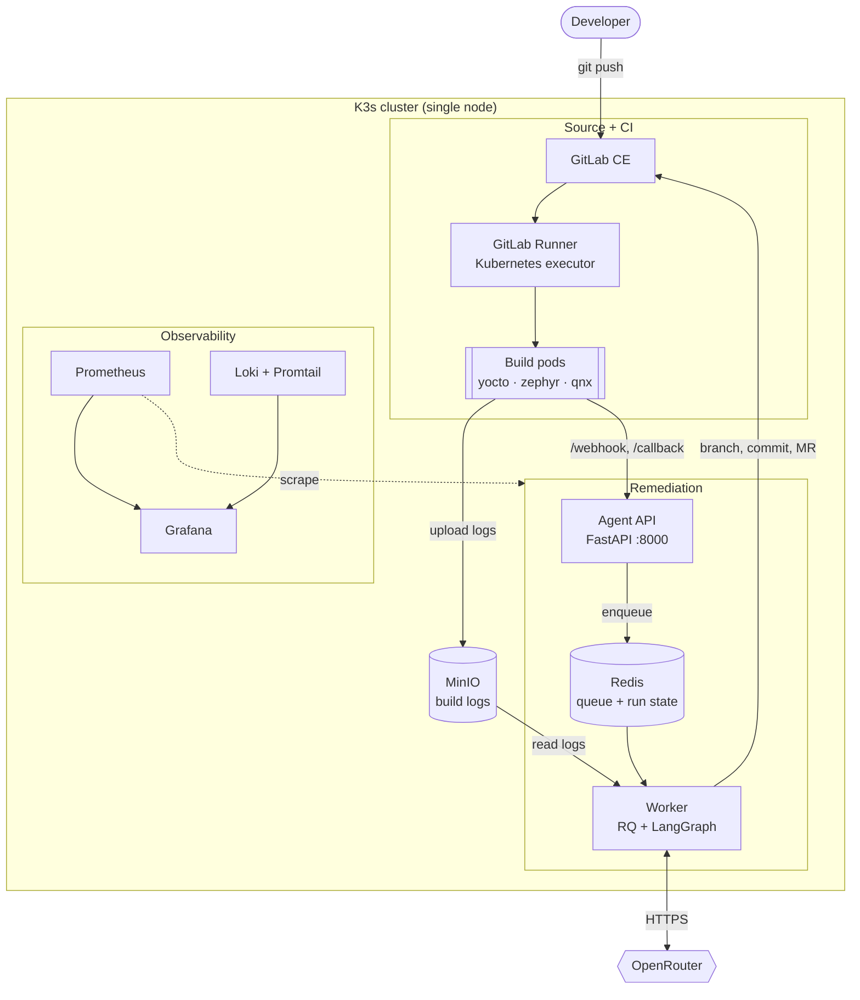
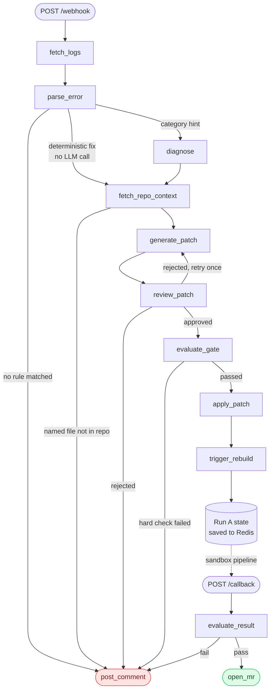

<p align="center">
  
</p>

<p align="center">
  
  
  
  
  
  
</p>

# cicd-agentic

A self-hosted CI/CD platform for embedded projects (Yocto, Zephyr, QNX-style C) that runs on one Linux machine. When a build fails, an agent reads the log, finds the failing line, pulls the real file from GitLab, writes a patch, rebuilds it on a sandbox branch, and opens a merge request if the rebuild passes.

The agent never pushes to a protected branch and never merges. Every fix lands on an `ai-fix/<pipeline_id>` branch and waits for a human.

**Contents:** [How it works](#how-it-works) · [Architecture](#architecture) · [Agent pipeline](#agent-pipeline) · [Safety model](#safety-model) · [Quick start](#quick-start) · [Operations](#operations) · [Observability](#observability) · [Repository layout](#repository-layout) · [Limitations](#limitations)

---

## How it works



The work is split in two runs so no worker sits idle waiting on a build. Run A ends once the sandbox pipeline is triggered and its state is saved to Redis. Run B starts when the sandbox pipeline calls back. A reaper inside the worker closes out any sandbox run whose callback never arrived (every 10 minutes by default).

---

## Architecture

Everything runs as pods in the `default` namespace of a single-node K3s cluster. Target machine: Ubuntu 22.04+, 24 GB RAM, 50 GB free disk.



The API and the worker are separate deployments built from the same image. The API only accepts webhooks and enqueues jobs, so a slow LLM call never blocks ingestion, and either side can restart on its own. Because they are separate processes, each exposes its own Prometheus endpoint.

| Component | Role | In-cluster address |
|---|---|---|
| GitLab CE | Git hosting, CI pipelines, merge requests | `http://gitlab` |
| GitLab Runner | Kubernetes executor, one pod per job | n/a |
| Agent API | `/webhook`, `/callback`, `/webhook/mr`, `/health`, `/metrics` | `http://agent:8000` |
| Worker | Runs the LangGraph graphs and the reaper | `http://worker-metrics:9100` |
| MinIO | Build log and task log storage (`build-logs` bucket) | `http://minio:9000` |
| Redis | Job queue, saved Run A state, MR idempotency keys | `redis:6379` |
| Prometheus, Grafana, Loki | Metrics, dashboards, pod logs | see [Observability](#observability) |

---

## Agent pipeline

Each box is one file in [`agent/core/nodes/`](agent/core/nodes). The graphs are wired in [`agent/core/graph.py`](agent/core/graph.py).



### Rules first, LLM second

Before any model is called, a regex signature table in [`agent/core/rules/`](agent/core/rules) classifies the failure. A Yocto checksum mismatch carries its fix in the log itself, so it is patched with zero LLM calls. For every other match, the category and candidate files are passed to the diagnostician so it starts from a narrowed prompt.

| Build type | Categories recognised |
|---|---|
| Yocto | `checksum` (deterministic fix), `fetch`, `dependency`, `compile`, `missing_include`, `linker`, `configure`, `task` |
| Zephyr | `compile`, `missing_include`, `linker`, `cmake`, `config` |
| QNX-style C | `compile`, `missing_include`, `linker`, `make` |

### Models

Configured in [`agent/services/openrouter_client.py`](agent/services/openrouter_client.py). If a model fails, the next one in its chain is tried. The chains mix providers on purpose: OpenRouter's free tier rate-limits per upstream provider, and paid calls can return 402 even with credits loaded.

| Role | Primary | Fallbacks, in order |
|---|---|---|
| Diagnostician | `qwen/qwen3-coder:free` | `qwen/qwen3-coder`, `google/gemma-4-31b-it:free`, `nvidia/nemotron-3-super-120b-a12b:free` |
| Patch generator | `deepseek/deepseek-chat-v3-0324` | `nvidia/nemotron-3-super-120b-a12b:free`, `openai/gpt-oss-20b:free` |
| Reviewer | `anthropic/claude-sonnet-4-5` | `openai/gpt-oss-20b:free`, `google/gemma-4-31b-it:free` |

If every model in a chain fails, the agent posts a "manual review needed" comment instead of crashing.

---

## Safety model

The reviewer's confidence score is not what decides whether a patch ships. `evaluate_gate` runs checks computed from real data, and any failed hard check stops the run before a sandbox build is spent.

| Check | Type | Fails when |
|---|---|---|
| `paths_exist` | hard | the patch edits a file that was never fetched from the repo (a hallucinated path) |
| `content_changed` | hard | the patch is a no-op |
| `diff_confined` | hard | the patch touches a file outside the ones investigated |
| `reviewer_approved` | hard | the reviewer model rejected the patch |
| `diff_small` | soft | the diff is large: MR is opened as Draft |
| `known_category` | soft | the rules engine did not recognise the failure: MR is opened as Draft |

Other guardrails:

- `/webhook`, `/callback` and `/webhook/mr` reject any request whose `X-Gitlab-Token` does not match `WEBHOOK_SECRET`, so a forged failure cannot spend LLM budget or create branches.
- At most 2 remediation attempts per commit SHA (`MAX_ATTEMPTS`). The third returns HTTP 429.
- Model output is never executed. Build logs are untrusted text, and the only thing the agent can write is a commit on a disposable `ai-fix/*` branch.
- The GitLab token is project-scoped (`api`, `read_repository`, `write_repository`), not a personal admin token.
- Secrets live in a Kubernetes Secret built from `.env` by [`infra/scripts/apply-env-secret.sh`](infra/scripts/apply-env-secret.sh). `.env` is gitignored.
- Opening a merge request is idempotent: a duplicate callback does nothing.

---

## Quick start

Requirements: Ubuntu 22.04+, Docker, `sudo`, about 24 GB RAM and 50 GB of disk, and an [OpenRouter API key](https://openrouter.ai/keys).

Two steps (`make build-images` and `make build-agent`) need an interactive `sudo` password because they import images into K3s's own containerd store.

**1. Configure**

```bash
git clone https://github.com/yessineabdelmaksoud/cicd-agentic.git
cd cicd-agentic
cp .env.example .env
```

Set `OPENROUTER_API_KEY` in `.env`, and set `WEBHOOK_SECRET` to the output of `openssl rand -hex 32`. Leave the GitLab token and project ID empty for now.

**2. Deploy the stack**

```bash
make up
watch kubectl get pods
```

`make up` installs K3s if it is missing, applies every manifest under `infra/k3s/`, and creates the `env-secret`. GitLab takes 3 to 5 minutes to come up.

**3. Bootstrap GitLab**

```bash
kubectl exec deployment/gitlab -- cat /etc/gitlab/initial_root_password
make setup-gitlab
make register-runner
```

Sign in at http://localhost as `root` with the printed password (it expires 24 hours after first boot). `make setup-gitlab` prints a `GITLAB_PROJECT_TOKEN`: copy it into `.env`.

**4. Build images and the agent**

```bash
make build-images
make apply-secret
make build-agent
```

**5. Verify**

```bash
make verify-day1
make verify-day3
```

The first script checks the infrastructure. The second checks the agent's health endpoint, webhook auth, the attempt cap and `/metrics`.

### Try it

Push a real error to a demo project and watch the worker handle it:

```bash
make inject-error p=zephyr-demo type=compile
kubectl logs -f deployment/worker
```

Within a few minutes you should see an `ai-fix/<pipeline_id>` branch, a sandbox pipeline, and either a merge request labelled `ai-fix` or a comment on the failing commit explaining why no fix was proposed. `make inject-error p=yocto-demo type=src_uri` breaks a Yocto checksum instead, which exercises the zero-LLM path.

The full walkthrough, including how to wire a demo project's `.gitlab-ci.yml` to the agent, is in [IMPLEMENTATION.md §6](IMPLEMENTATION.md#6-running-a-real-end-to-end-test).

---

## Operations

Run `make help` for the full list. The ones used day to day:

| Command | What it does |
|---|---|
| `make start` | Start K3s after a reboot, wait for pods, restart CoreDNS, run health checks |
| `make stop` | Stop K3s at the end of the day. All data stays on disk |
| `make status` | `kubectl get pods` |
| `make logs s=worker` | Follow logs for one deployment |
| `make build-agent` | Rebuild the agent image, import it, roll out agent and worker |
| `make apply-secret` | Recreate `env-secret` after editing `.env` |
| `make test` | Unit and integration tests, all external calls mocked |
| `make demo` | Scripted run: inject an error, wait, check for an MR |
| `make clean` | Delete every pod **and volume**. Asks for confirmation |

Troubleshooting for DNS failures after a restart, OpenRouter 429/402 errors, OOM-killed jobs and similar is in [IMPLEMENTATION.md §10](IMPLEMENTATION.md#10-troubleshooting).

---

## Observability

All UIs are served through the K3s Traefik ingress on port 80. No port-forwarding needed.

| Service | URL |
|---|---|
| GitLab | http://localhost |
| Grafana | http://grafana.localhost (user `admin`, password from `GRAFANA_ADMIN_PASSWORD`) |
| Prometheus | http://prometheus.localhost |

The `agent-metrics` Grafana dashboard tracks:

- LLM latency and estimated cost per remediation (`agent_llm_duration_seconds`, `agent_llm_cost_usd_total`)
- Time spent in each graph node (`agent_node_duration_seconds`)
- Fix outcomes, gate rejections by check, and reviewer confidence
- Merge requests opened versus actually merged by a human (`agent_mr_opened_total`, `agent_mr_merged_total`)
- Queue depth and active jobs

A second dashboard, `build-health`, shows build success and failure rate, build duration, agent triggers per hour and active jobs. Pod logs from every service are searchable in Grafana's Explore view through Loki.

Node-level metrics are only emitted by the worker process. If they all read zero, you are looking at the API's `/metrics` instead of `worker-metrics:9100`.

---

## Repository layout

```
.
├── agent/                  Agent API + worker (one image, two deployments)
│   ├── api/                FastAPI routes and request schemas
│   ├── core/
│   │   ├── graph.py        Run A and Run B LangGraph definitions
│   │   ├── state.py        AgentState passed between nodes
│   │   ├── nodes/          One file per pipeline step
│   │   └── rules/          Regex signatures for yocto, zephyr, qnx
│   └── services/           GitLab, MinIO, OpenRouter, Redis, metrics, reaper
├── docker/                 Build images: yocto, zephyr, qnx
├── pipelines/templates/    notify.yml (on failure) and validate.yml (sandbox callback)
├── infra/
│   ├── k3s/                Kubernetes manifests, applied with kubectl apply -R
│   └── scripts/            Setup and verification scripts
├── observability/          Prometheus, Grafana, Loki and Promtail config
├── scripts/                Deploy, demo and error-injection scripts
├── tests/                  Unit (rules, parser, gate) and integration (full graphs, mocked)
└── docs/                   Project brief, team plan, assets
```

---

## Testing

```bash
make test-unit          # rules engine, log parser, evaluate_gate
make test-integration   # full Run A and Run B graphs with LLM, GitLab and MinIO mocked
```

Neither suite needs a running cluster or network access.

---

## Limitations

- The Yocto image exists, but most end-to-end testing so far has used the Zephyr demo. Real Yocto validation with a shared `sstate-cache` is not done yet.
- The diagnostician sees the error span and the files it names. There is no semantic index of the whole codebase.
- Patches are full-file rewrites for files under about 250 lines, and line-range splices above that. Diff-only patches are on the backlog.
- QNX builds use a cross-compiled C stand-in, since there is no QNX SDP license.
- Single node only.

Planned work is tracked in [`to-add.md`](to-add.md).

---

## Further reading

| Document | Contents |
|---|---|
| [IMPLEMENTATION.md](IMPLEMENTATION.md) | Full operator guide: networking, security notes, troubleshooting |
| [docs/project-brief.md](docs/project-brief.md) | Original internship brief and requirements |
| [docs/8week-plan.md](docs/8week-plan.md) | Team delivery plan |
| [doc/history/](doc/history) | Day-by-day notes from before the v5 redesign |
